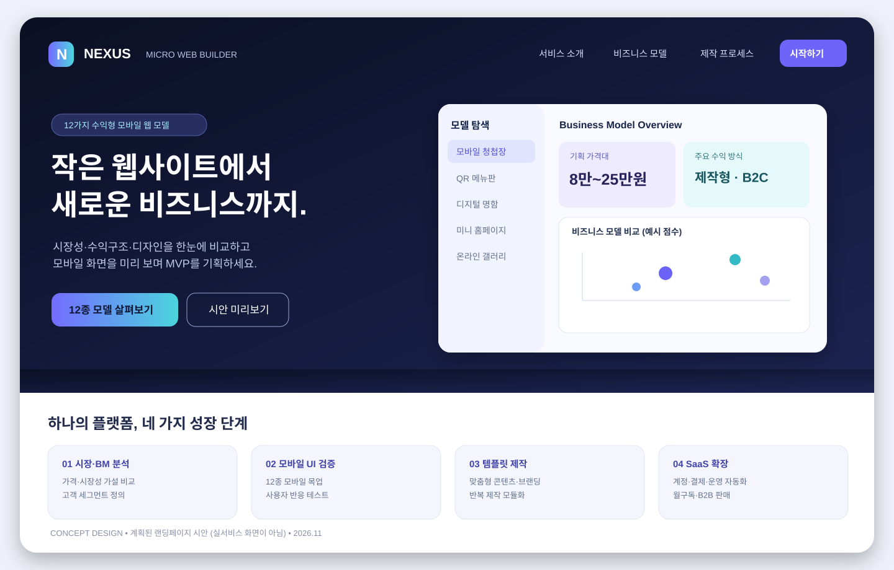
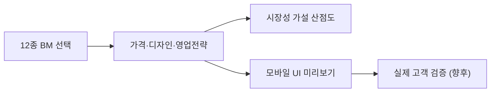
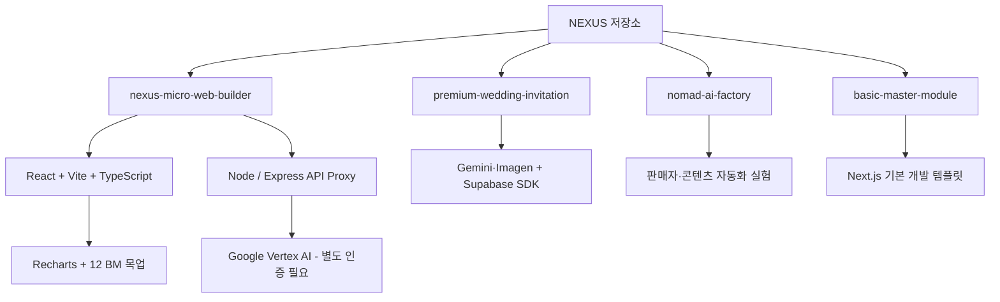

# NEXUS · Micro-Web Builder

**12가지 마이크로 웹 비즈니스 모델을 탐색하고, 수익 가설·디자인·영업 전략과 모바일 UI를 비교하는 실험형 플랫폼**

> **현재 상태: 프로토타입·기획 검증** — 정식 SaaS 출시나 12개 상품의 실판매를 의미하지 않습니다. 본 저장소는 하위 프로젝트 4개로 구성되어 있습니다.



*위 이미지는 향후 구축할 **랜딩페이지 디자인 컨셉**입니다. 실제 배포 페이지 캡처가 아닙니다.*

## 목차

1. [프로젝트 개요](#프로젝트-개요)
2. [12가지 비즈니스 모델](#12가지-비즈니스-모델)
3. [기능 및 UI 설계](#기능-및-ui-설계)
4. [시스템 구조](#시스템-구조)
5. [저장소 구성](#저장소-구성)
6. [개발 로드맵](#개발-로드맵)
7. [개발 및 실행](#개발-및-실행)
8. [주의사항 및 라이선스](#주의사항-및-라이선스)

## 프로젝트 개요

NEXUS는 청첩장·돌잔치 초대장·디지털 명함·QR 메뉴판·소상공인 미니홈피 등 작은 웹서비스의 **가격 가설, UI 아이디어, 영업 채널, 고객 가치**를 한 화면에서 탐색하는 BM 기획 도구입니다. 향후 고객이 템플릿을 선택해 맞춤 웹페이지를 배포하는 제작형·구독형 SaaS로 확장하는 것을 목표로 합니다.

**핵심 사용자**: 1인 웹제작자, 소상공인, 디자인·마케팅 대행사, 콘텐츠 제작자.

**현재 확인된 기능**: 12종 모델 목록/선택, Recharts 기반 수요·수익성 가설 산점도, 가격·디자인·마케팅 전략 패널, 모델별 모바일 목업, Vertex AI 연결을 위한 Express 프록시 구성.

**구현되지 않았거나 검증이 필요한 영역**: 정식 고객 로그인·결제·도메인 자동발급·고객별 템플릿 편집·실매출 분석. AI API 기능은 인증과 운영 환경 설정이 필요합니다.

## 12가지 비즈니스 모델

| 모델 | 코드에 등록된 기획 가격 | 수익화 가설 |
|---|---:|---|
| 프리미엄 모바일 청첩장 | 80,000~250,000원 | 건별 제작 |
| 돌잔치 모바일 초대장 | 40,000~100,000원 | 제작·제휴 |
| 부고장 / 조의장 | 30,000~60,000원 | 제작·B2B |
| 디지털 명함 | 월 4,900원부터 | 구독 |
| 소상공인 미니 홈피 | 200,000~600,000원 | 구축·유지보수 |
| 행사 / 세미나 안내장 | 150,000~400,000원 | 제작 |
| 부동산 모바일 전단 | 100,000~300,000원 | 제작·정액 |
| 프리랜서 포트폴리오 | 150,000~450,000원 | 제작 |
| 온라인 롤링페이퍼 | 무료~9,900원 | 프리미엄 |
| QR 모바일 메뉴판 | 초기 150,000원 + 월 15,000원 | 설치·구독 |
| 반려동물 QR 프로필 | 25,000~45,000원 | 제작·굿즈 |
| 온라인 전시 / 갤러리 | 300,000~1,000,000원 | 제작·옵션 |

> 가격·시장성 산점도 점수는 `frontend/data/models.ts`의 **기획 데이터와 임의 점수**이며, 실측 시장 규모나 입증된 매출이 아닙니다.

## 기능 및 UI 설계

### 랜딩페이지 (목표 시안)

- **Hero**: “작은 웹사이트에서 새로운 비즈니스까지” 카피, 모델 탐색/미리보기 CTA.
- **BM Gallery**: 고객 업종별 12종 필터, 가격·수익 방식·핵심 가치.
- **Interactive Preview**: 모바일/데스크톱 미리보기, 색상·폰트·이미지 테마.
- **How It Works**: 모델 선택 → 콘텐츠 입력 → 미리보기 → 상담/제작 → 배포.
- **Pricing & FAQ**: 제작형/구독형 구분, 추가 수정·유지관리 정책.
- **Trust & Contact**: 사용 사례(실고객 확보 후), 작업 의뢰·문의 폼.

**시각 디자인 가이드**: 인디고·다크 네이비 브랜드, 은은한 시안 그라디언트, 12열 벤토 그리드, 명확한 카드 계층, 360px 모바일 우선 레이아웃, AA 대비 준수. [컨셉 이미지 보기](docs/images/nexus-landing-concept.svg)

### 현재 대시보드 흐름



## 시스템 구조



현재 아키텍처, 목표 SaaS 아키텍처, 데이터 모델 및 보안 체크리스트: **[docs/ARCHITECTURE.md](docs/ARCHITECTURE.md)**

## 저장소 구성

```text
/
├── README.md                        # 프로젝트 전체 소개 (이 문서)
├── docs/
│   ├── ARCHITECTURE.md             # 현행/목표 구조, 보안, 데이터
│   ├── ROADMAP.md                  # 우선순위 및 사업화 검증
│   └── images/
│       └── nexus-landing-concept.svg
├── nexus-micro-web-builder/        # 12종 BM 분석 대시보드
│   ├── frontend/                   # Vite·React, 데이터·목업
│   └── backend/                    # Vertex AI Express 프록시
├── premium-wedding-invitation/     # AI 모바일 청첩장
├── nomad-ai-factory/              # 커머스·콘텐츠 자동화 실험
└── basic-master-module/           # Next.js 스타터
```

각 하위 프로젝트의 `README.md` 및 `CLAUDE.md`에서 세부 설정을 확인할 수 있습니다.

## 개발 로드맵

| 단계 | 목표 | 핵심 개선 |
|---|---|---|
| **P0: 안정화** | 재현 가능한 데모 | 빌드·E2E·의존성 버전 고정·보안·라이선스 |
| **P1: 린 검증** | 첫 유료 수요 확인 | 청첩장+QR 메뉴판 2개 템플릿, 고객 인터뷰/문의 |
| **P2: SaaS MVP** | 반복 제작 자동화 | 인증·RLS·CMS·배포·도메인·결제 |
| **P3: 확장** | B2B·화이트라벨 | 12종 카탈로그·사용량 과금·대행사 운영 |

상세 체크리스트, 완료 기준, 수익 가설: **[docs/ROADMAP.md](docs/ROADMAP.md)**

## 개발 및 실행

Node.js와 npm 설치가 필요합니다. Vertex AI 사용 시 Google Cloud 프로젝트·인증 및 해당 프로젝트의 권한이 필요합니다.

```bash
git clone https://github.com/theBestTrade/nexus-micro-web-builder.git
cd nexus-micro-web-builder/nexus-micro-web-builder
npm install
npm run dev
```

기본 개발 모드는 프론트엔드(Vite) 및 백엔드(Express)를 병렬 실행합니다. Google API를 호출하는 경우 `gcloud auth application-default login` 및 하위 프로젝트 `backend/.env.local` 설정이 필요합니다. **실제 키와 인증 파일은 절대 커밋하지 마세요.**

다른 앱 실행은 각 하위 디렉터리의 `README.md`를 참조하세요.

## 주의사항 및 라이선스

- **상업 서비스 운영 준비 전**: 계정 인증, API 프록시 보안, 개인정보 처리, 라이선스·이미지·음원 권리, 결제·환불 정책을 보완해야 합니다.
- GitHub에서 **공개 저장소인 것과 오픈소스 재사용 라이선스가 부여된 것은 다릅니다.** 전체 저장소의 루트 LICENSE가 확인되지 않았으므로 제3자의 복제·배포·상업 재사용 권한을 임의로 가정하지 않습니다.
- Vertex AI 및 상용 생성형 AI API의 과금·약관은 각 제공자의 최신 정책을 별도 확인해야 합니다.
- 디자인 시안 및 미래 아키텍처는 **계획 자료**이며 정식 운영 실적이 아닙니다.

---

**마지막 문서 개정:** 2026-11-08 · **저장소:** [theBestTrade/nexus-micro-web-builder](https://github.com/theBestTrade/nexus-micro-web-builder)
