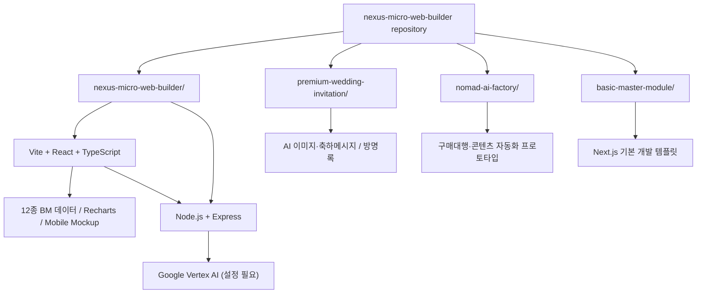
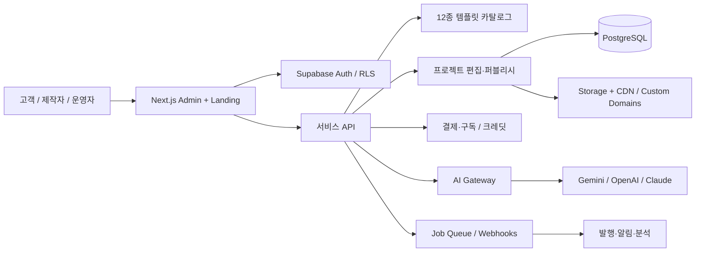

# 시스템 아키텍처 · Nexus Micro-Web Builder

> **근거 구분**: 아래의 현재 구조는 저장소 소스 및 CLAUDE.md 기준, 목표 구조는 제안사항입니다. 일부 AI 호출은 클라우드 인증 설정 없이는 동작하지 않을 수 있습니다.

## 현재 저장소 구조

## 사용 기술과 검증 범위

| 영역 | 현재 | 주의 |
|---|---|---|
| UI | React, TypeScript, Vite, Tailwind CSS, Lucide | 12종 미리보기는 데이터 기반 목업 |
| 분석 | Recharts 산점도 | 데이터의 수요·수익 점수는 가정치 |
| 프록시 | Express / Google ADC / REST·WebSocket | 프로덕션 인증·CORS·요청 제한 재검증 필요 |
| 청첩장 | React / Framer Motion / Gemini·Imagen / Supabase SDK | 실제 API 키·DB·도메인 연결은 별도 |
| 판매자 도구 | AI 콘텐츠 / React Flow 기반 UI | 외부 마켓 실거래 자동화는 별도 검증 |
| 템플릿 | Next.js 기본 골격 | 공통 패키지로 추출된 상태는 아님 |

## 권장 목표 아키텍처 (미구현)

## 권장 최소 데이터 모델

- `users`, `organizations`, `memberships`: 계정 / 멀티테넌트 권한.
- `templates`, `template_versions`: 12종 템플릿·버전·라이선스.
- `projects`, `project_pages`, `assets`: 고객별 프로젝트, 콘텐츠, 미디어.
- `domains`, `deployments`: 사용자 도메인·배포 이력.
- `orders`, `subscriptions`, `payments`: 제작형 상품과 구독형 상품.
- `ai_jobs`, `usage_ledger`: 모델 사용량·비용·실패 기록.
- `leads`, `events`: 상담·전환 추적.

## 보안 필수사항

1. API 키는 브라우저가 아닌 서버 비밀 관리 영역에 저장하고 세션/사용자별 권한을 검증합니다.
2. Google ADC는 개발용과 운영용 서비스 계정을 분리합니다.
3. RLS, 사용자별 리소스 소유권, 요청량 제한 및 결제 웹훅 서명을 검증합니다.
4. 고객 개인정보, 방명록, 청첩장 계좌 정보에 접근 제한·삭제 정책을 적용합니다.
5. AI 이미지의 지도 표현은 실제 길 안내용으로 사용하지 않고 검증된 지도 제공자 링크로 대체합니다.
6. 오픈소스 라이선스·서체·이미지·배경음악의 상업적 재사용 조건을 확인합니다.
